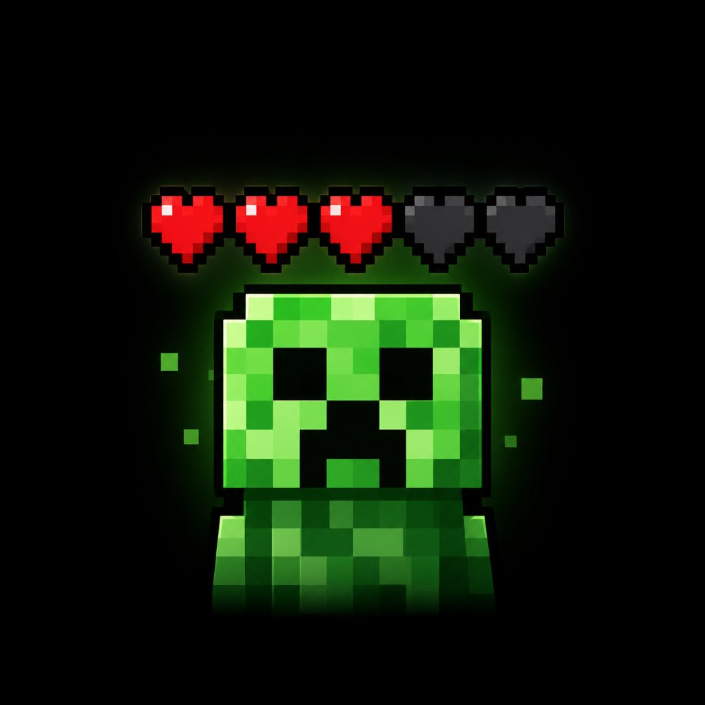

<div align="center">



# Shhh Mob Health Indicators

**A modern, client-side Fabric mod for Minecraft 26.3 featuring authentic pixel-art heart textures, RPG tiered hearts for high-health bosses, category filtering (hostile, passive, boss), 5 visual presets, and an in-game settings menu.**

[](LICENSE)
[](https://github.com/rafayshhh/shhh-mob-health-indicators)
[](https://fabricmc.net)
[](https://fabricmc.net)

<br/>

*Track monsters, animals, and bosses cleanly with authentic vanilla heart textures, absorption shields, RPG tiered hearts, and zero HUD clutter. Dedicated strictly to mobs with zero player interference.*

</div>

---

## 📌 Supported Versions

| Minecraft Version | Mod Loader | Java Version | Directory | Status |
| :--- | :--- | :--- | :--- | :--- |
| **26.3** | Fabric Loader | Java 25+ | [`26.3`](26.3) | Ready for Release |

---

## ✨ Features

- **Mob-Dedicated Health Engine**:
  - Exclusively targets living mobs, monsters, animals, and bosses (`LivingEntity`).
  - **Zero Player Interference**: Completely excludes all players and avatars (`Avatar` / `Player`), ensuring 100% seamless coexistence with player indicator mods like *Shhh Player Health Indicators*.
  - Excludes non-mob entities like Armor Stands.
- **Authentic 9x9 Pixel-Art Heart Sprites**:
  - Replaces flat unicode text glyphs with true 9x9 pixel-art Minecraft heart sprites generated directly from official vanilla assets.
  - Features iconic black borders, specular highlights, and shaded depth.
  - Fully integrated into Minecraft's font pipeline: 100% billboarded, shader/Iris/Sodium compatible, and automatically adapts nameplate background padding.
- **High-Health & Boss RPG Tiered Hearts**:
  - Accurately tracks high-capacity health pools (Iron Golems with 100 HP, Ravagers with 100 HP, Withers with 300 HP, Wardens with 500 HP).
  - Automatically switches to **RPG Tiered Hearts** (`x5 ❤❤❤❤❤❤❤❤❤❤ 100/100`) with 5 radiant tier colors (Red, Gold, Lime, Cyan, Magenta) for mobs with > 12 containers (> 24 HP).
- **Flexible Mob Category Filtering**:
  - **Hostile Mobs**: Toggle indicators on monsters and aggressive enemies (Zombies, Skeletons, Creepers, Endermen, Blazes, etc.).
  - **Passive Mobs**: Toggle indicators on animals and friendly creatures (Cows, Sheep, Pigs, Chickens, Horses, Villagers, etc.).
  - **Boss Mobs**: Toggle indicators on bosses (Wither, Warden, Elder Guardian, etc.).
  - **Named Mobs Only**: Option to only show health indicators on mobs that have custom name tags.
  - **Hide at 100% HP**: Reduce screen clutter by hiding indicators for unharmed mobs at full health.
  - **Hide Invisible**: Automatically hide indicators for invisible mobs.
- **5 High-Contrast Visual Presets**:
  - **Classic Hearts** *(Default)*: Full red hearts, coral half hearts, empty containers, and golden absorption hearts. On high-health mobs (> 12 containers), seamlessly switches to **RPG Tiered Hearts**.
  - **Compact**: High-contrast modern HUD with bold dynamic status color on current HP, dark slate `/` divider, silver max HP, and brilliant gold absorption (`❤ 20/20 HP`).
  - **Health Bar**: Seamless, solid 10-segment bar with deep charcoal background blocks and gold absorption extensions (`[██████████] 20/20`).
  - **Minimal Numeric**: Clean tactical badge (`❤ 20.0 / 20.0 HP`).
  - **RPG / Hearts**: Dual Heart + HP display (`❤ 10/10 Hearts  20/20 HP`).
- **Heart Texture Styles**:
  - Choose between `Vanilla (Textured)`, `Hardcore (Textured)`, and `Unicode (❤)` in settings.
- **Flexible Positioning**:
  - **Above Name Tag** *(Default)*: Cleanly stacked above the mob's nameplate.
  - **Below Name Tag**: Positioned between the mob's head and their nameplate.
- **In-Game Settings Screen**:
  - Native UI built with vanilla Minecraft layout components (two-column responsive layout).
  - Fully compatible with **ModMenu**.
- **Client-Side Only**:
  - Runs 100% locally on your client. No server installation required.

---

## ⌨️ Default Controls & Commands

### Keybindings
Keybindings can be rebound in **Options → Controls → Key Binds → Shhh Mob Health Indicators**:

| Action | Default Key | Category | What it does |
| :--- | :---: | :--- | :--- |
| **Toggle Mob Health Indicators** | <kbd>F12</kbd> | Shhh Mob Health Indicators | Quickly turns mob indicators ON or OFF |
| **Open Mob Health Settings Screen** | <kbd>0</kbd> | Shhh Mob Health Indicators | Opens the in-game configuration menu |

> [!NOTE]
> Keybindings include built-in screen guards (`client.gui.screen() == null`), so pressing `0` while typing in chat, search bars, creative inventory, signs, or containers will never accidentally open the settings screen.

### Client Commands
You can also configure the mod via client-side chat commands (aliases: `/smhi`, `/shhhmobhealth`):

| Command | Description |
| :--- | :--- |
| `/mobhealth` | Opens the configuration menu |
| `/mobhealth toggle` | Toggles mob health indicators ON or OFF |
| `/mobhealth preset <hearts\|compact\|bar\|numeric\|lifesteal>` | Quickly switches the active visual preset |
| `/mobhealth status` | Displays active settings and filters in chat |
| `/mobhealth help` | Shows available command arguments |

---

## ⚙️ In-Game Configuration

Access the configuration menu by pressing **`0`** in-game or via **Mod Menu**:

- **Mob Indicators**: Master ON / OFF toggle.
- **Preset**: Cycle between `Classic Hearts`, `Compact`, `Health Bar`, `Minimal Numeric`, and `RPG / Hearts`.
- **Position**: Toggle between `Above Name Tag` and `Below Name Tag`.
- **Heart Texture**: Toggle between `Vanilla (Textured)`, `Hardcore (Textured)`, and `Unicode (❤)`.
- **Hostile Mobs**: Toggle indicators on monsters and aggressive enemies.
- **Passive Mobs**: Toggle indicators on animals and friendly mobs.
- **Boss Mobs**: Toggle indicators on boss-tier entities.
- **Named Only**: Restrict indicators to mobs with custom name tags.
- **Hide at 100% HP**: Hide indicators when mobs are at full health.
- **Hide Invisible**: Hide indicators when mobs have the invisibility effect.
- **Absorption**: Toggle absorption / golden hearts visibility.
- **Max Distance**: Slider from 8m to 64m (default: 32m).
- **Dynamic Color Grading**: Color shifts dynamically based on remaining health percentage.

Settings are saved to `.minecraft/config/shhh-mob-health-indicators.json` with automatic corruption recovery.

---

## 📂 Repository Structure

```text
Shhh Mob Health Indicators/
├── 26.3/                     # Minecraft 26.3 Fabric mod project (Java 25)
│   ├── src/                  # Client source code, mixins, and resources
│   │   ├── client/           # Client-side renderers, GUI screens, and health tracker
│   │   └── main/             # Mod descriptors, font definitions, and sprite sheet
│   └── build.gradle          # Fabric Loom build script
├── Assets/                   # Logos, icons, and graphic assets
├── Documentation/            # Modrinth & CurseForge metadata, architecture, changelogs
├── .gitignore
├── LICENSE
└── README.md
```

---

## 👤 Author and Credits

- **Created by**: **RafayShhh**
  - GitHub: [@rafayshhh](https://github.com/rafayshhh)
  - Repository: [shhh-mob-health-indicators](https://github.com/rafayshhh/shhh-mob-health-indicators)

---

## 📄 License

This project is licensed under the [MIT License](LICENSE).  
*Not an official Minecraft product. Not approved by or associated with Mojang or Microsoft.*
